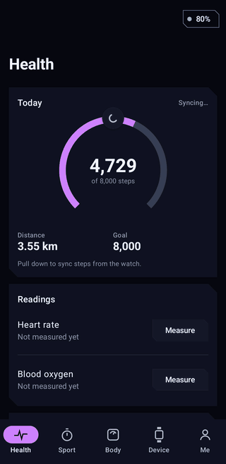
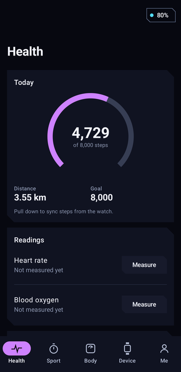
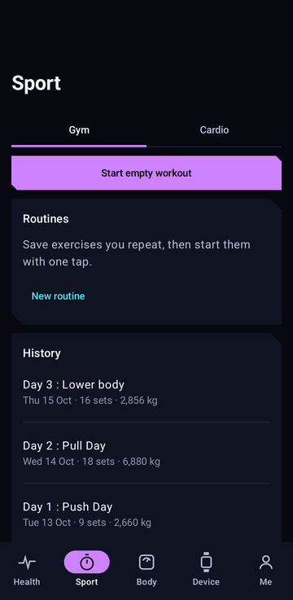
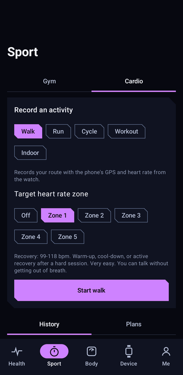
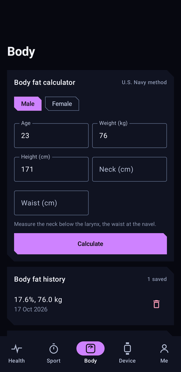
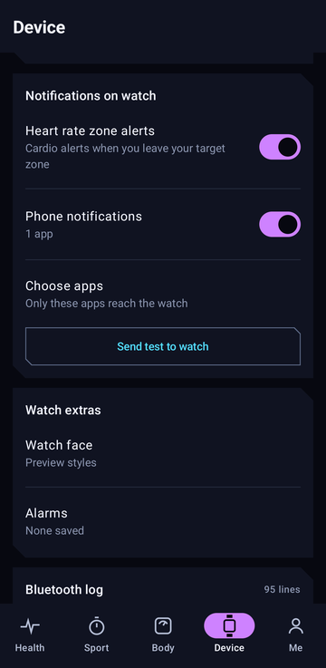

# Aolon Cyberpunk

My own Android app for the Aolon smartwatch. The official app works, but I wanted my data in my own Firebase, a dark UI I actually like looking at, and a gym log and cardio tracker in the same place as the watch. So I rebuilt it in Kotlin and Jetpack Compose.

It talks to the watch directly over Bluetooth. The watch uses the UTE protocol (the same family as GloryFit), and every command in `ble/WatchProtocol.kt` was worked out from how the official app talks to the watch, then checked against real packets from my own watch.

<p align="center">
  
</p>

<p align="center">
  
  
  
  
  
</p>

## What it does

Health shows steps by hour, heart rate and SpO2 measured on demand, and syncs the watch clock. My watch has no blood pressure sensor, so that row disappears whenever the watch reports it has none.

Sport has two tabs. Gym is a set-by-set log with routines, a rest timer that vibrates, personal records (estimated 1RM with the Epley formula), around 58 built-in exercises plus your own, and an import from Lyfta if you already log there. Any past workout can be repeated or saved as a routine.

Cardio records walks, runs and rides with the phone's GPS: a route on an OpenStreetMap map, distance, moving time, pace, per-km splits, and auto-pause when you stop. An indoor Workout mode records time and heart rate only. Heart rate comes from the watch during every activity.

Heart rate zones follow the common 220 minus age estimate with five bands (50 to 100 percent of max, as published by the Cleveland Clinic). Pick a target zone before you start and the app tells you, on the phone and on the watch, when you drift above or below it. After the activity you get time spent in each zone.

Body has a body fat calculator (the U.S. Navy method), weight and body fat tracking over time, and calories burned.

Watch notifications forward the phone notifications you choose, app by app, to the watch screen. Apps the watch knows (WhatsApp, Telegram, Gmail, Instagram and about 25 others) show with their own icon; everything else shows as Others with the app name in front.

Deleting anything is a soft delete with an Undo button, so a mis-tap never loses data.

## Things to know

- The watch only accepts one connection. Close the official Aolon app before using this one.
- Notifications reach the watch only while the app is running. If you swipe it away from recents, the Bluetooth link goes with it.
- The watch draws notification icons from its own built-in set. There is no way to send it a custom icon, which is why the app's own alerts show as Others.
- 220 minus age is an estimate. Your real max heart rate can be off by 10 bpm or more, so treat the zones as a guide.
- Emoji are removed from notifications before sending. The watch cannot draw them.

## Setting it up yourself

There is no shared server behind this app. You run it against your own Firebase project, which means your health data ends up in your account and nowhere else. The catch is that the repo ships without a Firebase config, so the build will fail until you add one.

You'll need Android Studio (or JDK 17+ with the Android SDK if you prefer the command line) and a phone running Android 8.0 or newer.

Start in the [Firebase console](https://console.firebase.google.com). Make a new project, then turn on two things: Realtime Database, and Google under Authentication > Sign-in method. Don't skip the second one. Enabling Google sign-in is what creates the web client ID the app logs in with.

Next, add an Android app to the project. Use `com.feri.aolon_cyberpunk` as the package name, and paste in the SHA-1 of the key you build with. Firebase uses it to decide which builds are allowed to sign in, and if it's missing or wrong, Google sign-in simply won't work. For a normal debug build you can print it with:

```
keytool -list -v -keystore ~/.android/debug.keystore -storepass android -alias androiddebugkey
```

Firebase then offers you a `google-services.json`. Drop it into the `app/` folder. It's in `.gitignore`, so you won't commit it by accident.

Before you record anything, open Realtime Database > Rules and replace the defaults with these, so every account can only see its own data:

```json
{
  "rules": {
    "aolon": {
      "users": {
        "$uid": {
          ".read": "$uid === auth.uid",
          ".write": "$uid === auth.uid"
        }
      }
    }
  }
}
```

Now build it and put it on your phone:

```
./gradlew assembleDebug
adb install -r app/build/outputs/apk/debug/app-debug.apk
```

The release build is signed with the debug key too. I did that on purpose so the one SHA-1 you registered works for both. If you ever want to publish the app, create a real release keystore and add its SHA-1 to Firebase as well.

To run the tests, use `./gradlew testDebugUnitTest`. They focus on the parts that are easiest to get wrong: body fat maths, gym records, the Lyfta import, GPS filtering and splits, heart rate zones, and the packets sent to the watch.

## Connecting Lyfta (optional)

If you already log your lifts in Lyfta, the app can pull them in so your old workouts show up next to the new ones. You don't need this to use the gym log, and you don't need a Lyfta developer account or an API key either. The first time you connect, the app registers itself with Lyfta as "Aolon Cyberpunk", so every install gets its own client and there is nothing to paste in.

To connect, open Sport > Gym, scroll down to Settings and tap Connect Lyfta. Your browser opens the Lyfta sign-in page. Log in with the account you train with, approve the access, and Lyfta sends you straight back to the app. The app only asks for read access to your training, so it can't change or delete anything in Lyfta.

After that it imports your latest 20 workouts and syncs again each time you open the app. There's also a Sync button if you don't want to wait. Running the import twice won't create duplicates. Exercises are matched to the built-in library by name, and anything it doesn't recognise becomes a custom exercise under Other. Lyfta doesn't send a workout duration, so imported sessions show sets and volume without a time.

The Lyfta login stays on your phone. It never goes to Firebase. Disconnect Lyfta signs you out and keeps the workouts you already imported.

One thing if you fork the project: Lyfta sends you back to the app through the address `aoloncyberpunk://lyfta/callback`. If you rename the app and change that address, change it in both `lyfta/LyftaClient.kt` (`REDIRECT`) and the intent filter in `AndroidManifest.xml`, or the browser won't know where to return you.

## Where the data lives

Everything you record goes to your own Firebase Realtime Database under `aolon/users/{your uid}`. With the rules above, only your Google account can read or write it. GPS routes are stored apart from the activity list so the history screen stays light.

A few things never leave the phone: the Lyfta sign-in tokens, the list of apps allowed to notify the watch, and the content of the notifications themselves. The in-app Bluetooth log also hides message text and shows only the packet header and length.

## Project layout

```
app/src/main/java/com/feri/aolon_cyberpunk/
  ble/       Bluetooth link and the UTE watch protocol
  cardio/    GPS recording, auto-pause, splits, heart rate zones
  gym/       Gym log, exercise library, records
  lyfta/     Lyfta sign-in and workout import
  notify/    Notification forwarding to the watch
  ui/        Compose screens
```

## Credits

Maps from OpenStreetMap contributors, drawn with osmdroid. Gym import uses the Lyfta API. This is a personal project and is not affiliated with Aolon, UTE or Lyfta.

## License

MIT. See [LICENSE](LICENSE). The licence covers the code in this repo, not the Aolon, UTE or Lyfta names, and not their apps.
